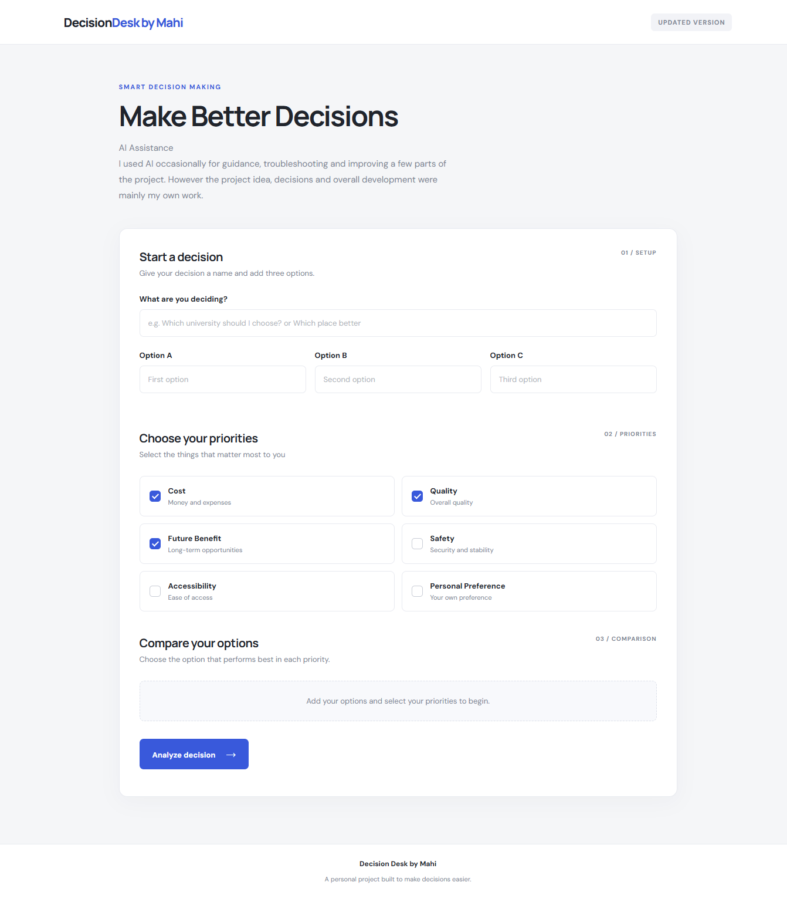

# Decision Maker by Mahi

A simple tool I made to compare different options and make decisions a little easier.

Sometimes choosing between a few options is not that easy. I originally created this project in Google Sheets to organize my thoughts and compare choices. Later, I made a web version to make it easier to use.

## Project Preview



## What It Does

The tool compares three options based on selected criteria and helps identify which one may be the better choice.

### Features

- Compare three different options.
- Set priorities using weighted scoring.
- Calculate scores for each option.
- Rank options based on their results.
- View a percentage-based comparison chart.
- Check basic risks before making a decision.
- Validate inputs to avoid empty or duplicate options.

## Technologies Used

- HTML
- CSS
- JavaScript
- Google Sheets (original version)

## Project Files

```text
Decision-Maker-by-Mahi/
│
├── index.html
├── style.css
├── script.js
├── Excel-Version/
└── README.md
```

## How to Use

1. Open the project repository.
2. Download or clone the repository.
3. Open `index.html` in a web browser.
4. Enter the options you want to compare.
5. Select the relevant criteria and priorities.
6. View the scores, rankings and comparison results.

No additional software is required to run the basic web version.

## What I Learned

While working on this project, I got some practical experience with:

- Working with HTML, CSS and JavaScript.
- Using JavaScript to handle user input.
- Applying weighted scoring to compare options.
- Displaying results in a visual format.
- Organizing a project into separate files.
- Improving an existing spreadsheet idea into a web application.

## Limitations

This is a basic decision-support tool, not a system that can guarantee the best decision.

The results depend on the criteria and priorities entered by the user. It is intended for simple comparisons rather than complex or high-risk decisions.

## Future Improvements

Some things I would like to work on in the future:

- Allow users to add more than three options.
- Make the scoring system more flexible.
- Improve the overall user interface.
- Add an option to save comparison results.

## Development Note

The original spreadsheet version was created by me. I later developed the web version with AI assistance while learning and experimenting with web technologies.
## Live Demo

Try the project here: [Decision Maker by Mahi](https://almahfujmahi.github.io/Decision-Maker-by-Mahi/)

## Author

**Mahfuj Mahi**

Computer Science & Technology Student

[GitHub](https://github.com/almahfujmahi)

